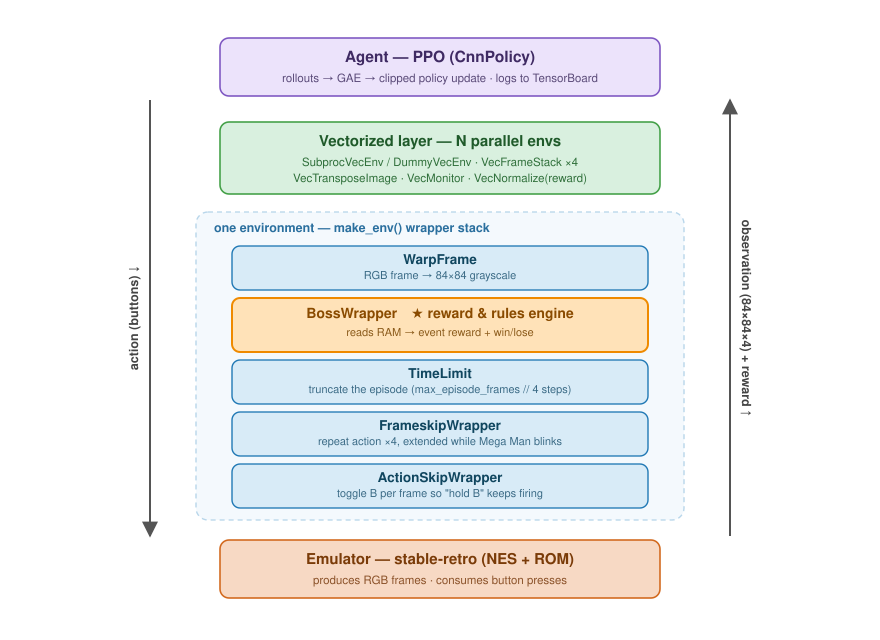

# Architecture Guide

*Read this in another language: **English** · [Português](ARCHITECTURE.pt-BR.md)*

This document explains how the project is built, what every class does, and how the pieces fit
together. It is written for someone who has **never seen the codebase** and is not assumed to be
an expert in reinforcement learning (RL). Read it top to bottom to navigate the codebase
with confidence.

> Summary — A neural network learns to play *Mega Man* (NES) boss fights by looking at the screen
> (just the pixels) and pressing buttons. The game runs inside an emulator; a stack of small
> "wrapper" classes turns raw game frames into the network's input and turns game-memory readings
> into a numeric reward. The PPO algorithm uses that reward to gradually improve the network.
> Sections 1-11 cover this PPO stack; section 12 shows how the genetic algorithms reuse it.

---

## 1. What problem are we solving?

We want an agent (a policy network) that **defeats a boss** in *Mega Man 1* using only what a human
would see — the pixels on the screen. The agent has no privileged access to the game's internal
state in its *observation*: it must infer everything (enemy position, its own health, projectile
timing) from the image.

This is framed as a **reinforcement learning** problem:

- At each step the agent receives an **observation** (the screen).
- It picks an **action** (a combination of buttons).
- The environment returns a **reward** (a small number telling the agent how well it is doing) and
  the next observation.
- The agent's goal is to maximize the total reward over an episode (one boss fight).

We use **PPO** (Proximal Policy Optimization), a popular and stable RL algorithm, from the
[stable-baselines3](https://stable-baselines3.readthedocs.io/) library. The NES game is emulated by
[stable-retro](https://github.com/Farama-Foundation/stable-retro).

### Mini-glossary (just enough to read on)

| Term | Meaning in this project |
|------|--------------------------|
| **Episode** | One boss fight, from reset until the boss dies, the player dies, or a time limit. |
| **Policy** | The neural network that maps an observation to an action. |
| **Observation** | An 84×84 grayscale image, stacked over the last 4 frames (`84×84×4`). |
| **Action** | A `MultiDiscrete([2, 5, 2])` choice `[B, D-pad, A]`: shoot, a D-pad direction (or none), jump. |
| **Reward** | `r = d·(hits − m·damage)`, where hits and damage are *events* (a step in which the boss / Mega Man lost HP); small positive for hitting the boss, negative for taking damage. |
| **Frameskip** | The agent acts once every N emulator frames (here N=4), to act on a human-like timescale. |
| **Frame stacking** | Feeding the last 4 frames so the network can perceive motion/velocity. |
| **PPO** | The training algorithm that updates the policy from collected experience. |
| **GAE** | Generalized Advantage Estimation — how PPO estimates "how much better than average" an action was. |
| **Boss HP** | The boss's health, read from emulator RAM. Reaching 0 = a win. |
| **Validation vs test** | Validation: the single deterministic episode that `train.py` plays every ~100k steps to stop and to pick `best_model.zip`. Test: `src/eval.py`, many episodes, optionally with sticky actions and no-op starts. |

---

## 2. The big picture

Data flows in a closed loop. The emulator produces a frame; a stack of wrappers transforms it into
the agent's observation and turns game-memory readings into a reward; the agent (PPO) chooses an
action; the wrappers translate it back into button presses; the emulator advances one step.
Periodically, PPO takes the collected `(observation, action, reward)` data and improves the policy.



**How to read the diagram:** the right-hand arrow is the **observation + reward** travelling
bottom-to-top; the left-hand arrow is the **action** travelling top-to-bottom. Start at the bottom:
the **emulator** emits a raw RGB frame, which flows up through the per-environment wrapper stack
(`make_env`) — each wrapper adds one transformation — then through the **vectorized layer** that runs
N copies in parallel and stacks the last 4 frames, and finally reaches the **PPO agent**. The
agent's chosen action travels back down the same path, where `ActionSkipWrapper` converts it into the
correct NES button cadence just before it reaches the emulator. The highlighted orange box,
`BossWrapper`, is where the reward and the win/lose conditions are computed.

Two scripts drive the PPO path:

- **`src/train.py`** — builds the environment, creates the PPO model, runs the training loop, saves
  checkpoints and the best model.
- **`src/eval.py`** — loads a saved model and measures whether it beats the boss (win and no-damage
  rates with confidence intervals, optionally under sticky actions and no-op starts).

They rely on **`src/env.py`** (to build environments) and **`src/wrappers.py`** (the transformation
classes). The game itself comes from **`custom_integrations/`** plus a user-supplied ROM.

---

## 3. Repository layout

```
src/
  wrappers.py   # the transformation classes (the heart of the env)
  env.py        # factory functions that assemble and vectorize environments
  train.py      # training entry point (PPO + callbacks + the fixed "recipe")
  eval.py       # test-time evaluation (sticky actions, no-op starts, Wilson intervals)
  __init__.py   # makes `src` an importable package
baselines/ga/                         # Deep GA and open-loop GA (section 12)
experiments/fair/                     # the comparison campaign (see EXPERIMENTS.md)
tests/                                # pytest suite (emulator tests are skipped without rom.nes)
custom_integrations/MegaMan-v1-Nes/   # the stable-retro game definition (no ROM)
docs/ARCHITECTURE.md                  # this file
docs/EXPERIMENTS.md                   # protocol of the comparison campaign
environment.yml / requirements.lock.txt   # exact environment (lock = full pip freeze)
README.md / README.pt-BR.md           # usage guide (English / Portuguese)
CITATION.cff                          # how to cite
```

Generated at runtime (not committed): `logs/` (TensorBoard and `run_meta.json`), `checkpoints/`,
`models/`, `campaign/`.

**Where to start reading:** `src/wrappers.py` (understand the env), then `src/env.py` (how it is
assembled), then `src/train.py` (how it is trained), then `src/eval.py`.

---

## 4. The environment, wrapper by wrapper

A "wrapper" is a class that wraps another environment, intercepting `reset()` and `step()` to add
behavior. They operate in nested layers: each wrapper delegates to the one inside it. The order matters. From innermost
(closest to the emulator) to outermost (closest to the agent), as assembled in `make_env`:

```
stable_retro.make(...)        # raw NES env: RGB image in, button presses out
  └─ ActionSkipWrapper        # fixes the shoot-button cadence (per emulator frame)
       └─ FrameskipWrapper     # acts every 4 frames (extended over "blink" frames)
            └─ TimeLimit        # truncates the episode after max_episode_frames // 4 agent steps
                 └─ BossWrapper  # computes the reward and win/lose conditions
                      └─ WarpFrame  # converts the image to 84×84 grayscale (outermost)
```

### 4.1 `ActionSkipWrapper`

**Problem it solves:** On the NES, Mega Man fires only when you *press* B — holding B does nothing
after the first shot. A naive policy that learns to "hold B" would fire once and then stop.

**What it does:** It keeps a one-bit toggle (`b_state`). When the agent requests "shoot"
(`action[0] == 1`), it lets the press through on one call and forces a release on the next, so a
policy that simply holds B still fires a continuous stream of shots. The jump button (A) is **not**
toggled.

The toggle runs **per emulator frame**, not per agent step: this wrapper sits *inside*
`FrameskipWrapper`, which calls it once for each of the 4 repeated frames. Holding B therefore
produces `1, 0, 1, 0` at the frame level, i.e. two press edges per agent step.

> Action layout used throughout the code: `action[0]` = B (shoot), `action[1]` = D-pad
> (none / UP / DOWN / LEFT / RIGHT, in this index order), `action[2]` = A (jump). It is a
> `MultiDiscrete([2, 5, 2])` space. **This is not the order in `scenario.json`** (which lists the
> D-pad, then A, then B): stable-retro sorts the button groups and the combinations inside each
> group by button bitmask, so the index order is `[B, D-pad, A]` and the D-pad combinations come out
> as none, UP, DOWN, LEFT, RIGHT. `tests/test_env_contract.py` pins this layout.

### 4.2 `FrameskipWrapper`

**Problem it solves:** The NES runs at ~60 frames/second. Deciding 60 times per second is wasteful
and makes credit assignment hard. Also, right after taking damage Mega Man "blinks" (flickers
invisible), so some of those frames carry little useful visual information. The wrapper tries to
skip them, but only approximately (see below).

**What it does:**
- Repeats the chosen action for `skip` (=4) emulator frames, summing their rewards.
- Then keeps stepping, repeating the same action, *while `blink_counter % 4 ∈ {1, 2}`* (and
  `blink_counter > 0`), up to a safety cap of 60 extra frames. So one agent step is 4 frames plus an
  extension of up to 60 frames.
- `blink_counter` (RAM 85) is an invincibility-frame timer, not a rendering flag, so the check is a
  heuristic and it is inaccurate: measured on the emulator, when it predicts "invisible"
  (`blink_counter % 4 ∈ {1, 2}`) Mega Man is actually visible in ~40% of the frames, and when it
  predicts "visible" he is visible in only ~90% of them. The counter also decrements irregularly
  (every 1-2 frames) and can freeze. Therefore the agent's next observation is **not** guaranteed to
  be a visible frame.
- During the extension the agent has **no control**: the action chosen for the step is repeated
  blindly, for up to ~1 s of game time right after taking damage. Steps are therefore of variable
  length (mean ~4.2-4.4 frames, up to 20% of the steps with more than 4 frames, longest observed
  47), which makes the process a semi-MDP with an undeclared step duration, and `TimeLimit` (below)
  counts agent steps, not frames, so the episode can last longer than `max_episode_frames`.

### 4.3 `TimeLimit` (from Gymnasium)

A standard wrapper that truncates the episode after `max_episode_steps`. We compute it as
`max_episode_frames // frameskip` (7200 frames = 1800 agent steps at skip 4). It counts agent steps,
so the length in frames is not exact while the blink extension runs.

### 4.4 `BossWrapper` — the reward and rules engine

This is the most important wrapper. It reads the game's RAM each step and turns it into the reward
and the episode-ending conditions. It never changes the *image* the agent sees; it only changes the
*reward* and *done* signals (and exposes useful values in the `info` dictionary).

**Reward function** (computed in `step`, once per agent step):

```
reward  = d                       if the boss lost HP this step          (a hit landed)
reward -= d * damage_penalty_mult if Mega Man lost HP this step          (took damage)
reward += win_bonus               on the step the boss reaches 0 HP      (terminal)
```

with `d = 0.05`. During **training** `damage_penalty_mult = 2.0` and `win_bonus = 0.5`; during
**evaluation** they revert to `1.0` and `0.0` (the real task). That is why a *flawless*
evaluation episode (killing the boss without taking damage) scores exactly `hits · d`.

The first two terms are **event indicators**: a step counts once whether the boss lost 1 or 14 HP,
and whether Mega Man lost 4 or 10 HP (the damage per event depends on the enemy). The reward
therefore ignores HP magnitudes and is not comparable across bosses; use the HP lost, the damage
events and the frames until the kill reported by `src/eval.py` for that.

**Termination conditions** (the episode ends when):
- Mega Man's health reaches 0, or the lives counter drops (death);
- Mega Man touches spikes (`touching_obj_top == 3` or `touching_obj_side == 3`);
- the boss's health reaches 0 (**win**);
- ammo runs out while the boss is still alive (`weapon_energy == 0`; it stays at 28 with the buster,
  so this only matters for ammo-limited weapons).

The episode also ends by truncation at the `TimeLimit`. A multi-phase boss (e.g. the Dr. Wily
fights), whose HP bar reaches 0 between phases, would end the episode at the first zero and count as
a false win; the six fights used here are single-phase, so this does not affect them.

**RAM values it reads**, through the integration's named variables (the full map, with the verified
meaning of each address, is in section 8): `health`, `lives`, `boss_health`, `weapon_energy`,
`touching_obj_top`, `touching_obj_side` (reward and termination), plus `x`, `y` and `screen`, which
are only passed through to `info`. On `reset` it reads the
real values from RAM with `lookup_value`. Nothing here is added to the agent's observation.

**Helper:** `_info_dict(...)` builds the per-step `info` dictionary (`hp`, `boss_hp`, `lives`, `x`,
`y`, `screen`, `weapon_energy`) in one place, used identically by `reset` and `step`. `VecMonitor`
records the final `hp` and `boss_hp` of every episode from it, which is how `train.py` classifies
validation episodes.

> Subtle but important detail handled in `reset`: stable-retro's `info` dictionary is often **empty** right
> after a reset. Relying on an incorrect default for `lives` would incorrectly register
> a life lost and terminate the episode prematurely.
> Therefore, `reset` reads the **real** values straight from RAM via `lookup_value`.

### 4.5 `WarpFrame`

Converts each RGB frame to grayscale and resizes it to 84×84 (`cv2.cvtColor` + `cv2.resize` with
`INTER_AREA`). This is the standard Atari-style preprocessing: color is unnecessary, and a smaller
image is much cheaper for the CNN. Output shape: `(84, 84, 1)`. This is the **outermost** wrapper,
so its output is exactly what the vectorized layer (next section) stacks and feeds to the policy.

---

## 5. Assembling and vectorizing environments — `src/env.py`

`env.py` contains the factory functions that build the wrapper stack above and then run many copies
of it in parallel.

- **`_register_custom_integrations()`** — tells stable-retro where to find our custom game
  (`custom_integrations/`). It runs once per process (a guard flag prevents repeated registration).
  This matters because parallel workers are separate processes that each re-import the module.

- **`_verify_rom(game)`** — checks `rom.nes` against `rom.sha` with `stable_retro.data.verify_hash`
  (once per process and game) and raises a `RuntimeError` with instructions if the file is missing or
  is another revision/dump. `stable_retro.make` alone only checks that `rom.nes` exists, so without
  this check a different ROM would load silently with the RAM addresses pointing at the wrong bytes.
  The hash convention is the SHA-1 of the ROM **without** the 16-byte iNES header (see section 8).

- **`make_env(...)`** — builds **one** environment: registers the integration, verifies the ROM,
  calls `stable_retro.make(...)` with `inttype=CUSTOM_ONLY` (use only our integration),
  `MULTI_DISCRETE` actions and `IMAGE` observations, then wraps it in the onion from Section 4.
  Returns a single Gym environment. The reward parameters (`d`, `win_bonus`, `damage_penalty_mult`), `frameskip`,
  `max_episode_frames` and `sticky` are passed straight through to the wrappers.

- **`make_venv(...)`** — builds **N** environments and stacks the vectorized layer on top:
  1. `SubprocVecEnv` (parallel processes) if `n_envs > 1`, else `DummyVecEnv` (in-process).
  2. `VecFrameStack(n_stack=4)` — stacks the last 4 grayscale frames → the agent's real input
     becomes `84×84×4`. This is what lets a feed-forward CNN perceive motion.
  3. `VecTransposeImage` — reorders axes to PyTorch's `(channels, height, width)`.
  4. `VecMonitor(info_keywords=("hp", "boss_hp"))` — records episode statistics.
  5. `VecNormalize(norm_obs=False, norm_reward=True)` — optional running normalization of the
     **reward only** (never the image), which sharpens the learning signal and is safe for evaluation.

  To avoid duplicating the long parameter list, the per-env settings are collected once into an
  `env_kwargs` dict and forwarded to each worker.

The result of `make_venv` is the single object that PPO interacts with: calling `.step(actions)` on
it advances all N environments at once and returns batched observations, rewards and `done` flags.

---

## 6. Training — `src/train.py`

### 6.1 The "recipe" (module-level constants)

Because the hyperparameters and the reward are **the same for every boss**, they are constants at
the top of the file. Only `LR` and `ENT_COEF` can be overridden (`--lr`, `--ent-coef`), which the
hyperparameter tuning of the comparison campaign uses.

- Reward: `D = 0.05`, `DAMAGE_PENALTY_MULT = 2.0`, `WIN_BONUS = 0.5`, `FRAMESKIP = 4`,
  `NORM_REWARD = True`.
- PPO: `LR = 2.5e-4` (linear decay), `ENT_COEF = 5e-3`, `TARGET_KL = 0.05`, `GAMMA = 0.99`,
  `GAE_LAMBDA = 0.95`, `CLIP_RANGE = 0.2`, `VF_COEF = 1.0`, `MAX_GRAD_NORM = 0.5`, `N_STEPS = 1024`,
  `BATCH_SIZE = 128`, `N_EPOCHS = 4`, `N_EVAL_EPISODES = 1`, `SEED = 666` (the default of `--seed`).
- The policy is SB3's `CnnPolicy` (NatureCNN) with **separate** feature extractors for the actor and
  the critic.

The command-line flags are:
- per run: `--tag`, `--state`, `--seed`, `--timesteps`, `--n-envs`, `--episode-frames`;
- early stop and regime: `--no-early-stop`, `--train-sticky`;
- tuning: `--lr`, `--ent-coef`;
- reproducibility: `--lr-horizon`, `--deterministic-torch`.

### 6.2 The learning-rate schedule

`lr_at_step(step, initial_value, horizon)` is `initial_value · max(0, 1 − step/horizon)`, and
`linear_schedule(initial_value, horizon, total_steps)` wraps it for SB3 (which calls it with
`progress_remaining`, mapped back to the absolute step). The LR decays linearly to 0 at `--lr-horizon`
(default: `--timesteps`, 40 M) and stays there. The campaign fixes `--lr-horizon` at 40 M, so the
schedule does not depend on the 3 M budget.

The decay is a scheduling choice, not something shown to help by itself. With a 3 M budget and a 40 M
horizon, the LR the agent sees stays close to its initial value (at 2 M steps it is 95% of it), which
is why `--lr-horizon` is explicit.

### 6.3 Validation callback (`ValidationCallback`)

Every `eval_freq` calls (~100k environment steps) `ValidationCallback`, a thin subclass of SB3's
`EvalCallback`, runs the current policy for **one deterministic episode** (`N_EVAL_EPISODES = 1`) on a
**separate evaluation environment** (the *real* task — no reward shaping, `damage_penalty_mult = 1.0`,
no win bonus). This is *validation*: a single trajectory, because both the emulator and the policy
are deterministic there. It:
- logs `eval/mean_reward` and `eval/mean_ep_length` to TensorBoard, and additionally `eval/win_rate`
  and `eval/no_damage_rate`, classifying each episode from the final `hp` / `boss_hp` that
  `VecMonitor` records (win = boss at 0 with Mega Man alive; no-damage win = win with 28 HP left);
- saves `best_model.zip` whenever the mean validation reward improves;
- stops training after the first validation whose episodes are all no-damage wins
  (`stop_on_no_damage`, read from `info`), unless `--no-early-stop` is set.

Since validation is one deterministic trajectory, "stopped on a no-damage win" is not evidence that
the policy is robust; `src/eval.py` (section 7) is the test.

### 6.4 `main()` — the training procedure

1. Parse the flags.
2. Set up torch determinism if `--deterministic-torch` (deterministic kernels, `CUBLAS_WORKSPACE_CONFIG`).
   Without it the script enables `cudnn.benchmark`, but SB3's seeding (`PPO(seed=...)`) then forces
   `cudnn.deterministic=True` and `benchmark=False`, so that line has no lasting effect; remaining
   non-determinism comes from non-deterministic CUDA operations.
3. Build two environments with `make_venv`:
   - **training env** — with the 2× damage penalty and the win bonus, plus sticky actions if requested;
   - **evaluation env** — the real task (no shaping), single environment, used by the callback.
4. Create the callbacks:
   - `RunMetaCallback` — writes the run metadata to TensorBoard as text;
   - `CheckpointCallback` — saves a checkpoint (and its `VecNormalize` statistics) every ~500k steps;
   - `ValidationCallback` — validates every ~100k steps, saves the best model, applies the stop rule.
5. Create the PPO model with `CnnPolicy`, the recipe constants and `--seed`.
6. Write `logs/<tag>/run_meta.json` (library versions, git commit and dirty flag, hardware, CLI
   arguments, recipe constants, torch determinism flags).
7. Call `model.learn(...)`. PPO repeatedly: collects a rollout of experience from the N parallel
   envs, computes advantages with **GAE**, and updates the network with the clipped PPO objective.
8. When training ends (early stop or the timestep ceiling), save `final_model.zip` (and its
   `VecNormalize` statistics) in addition to the `best_model.zip` produced by the callback.

**Outputs** (namespaced by `--tag`): `logs/<tag>/` (TensorBoard, `run_meta.json`),
`checkpoints/<tag>/` (periodic snapshots), `models/<tag>_best/best_model.zip` and
`.../final_model.zip`.

---

## 7. Evaluation — `src/eval.py`

This script answers the question *does this saved model actually beat the boss, and how robustly?*
It is the **test** protocol, as opposed to the single validation episode of section 6.3.

- **`make_eval_env(...)`** builds the same wrapper stack as `make_env` for the real task (`d=0.05`,
  1× penalty, no win bonus), plus two helpers right above the emulator, *below*
  `ActionSkipWrapper`:
  - `StickyFrames` — sticky actions **per emulator frame** (Machado et al. 2018): at every frame the
    previous frame's action is repeated with probability `--sticky`. Being below `ActionSkipWrapper`
    and `FrameskipWrapper`, both the B toggle and the frameskip operate on the perturbed actions;
  - `FrameCounter` — counts real emulator frames and damage events (drops of `health`, frame by
    frame), independent of how the wrappers stretch an agent step.
- **`run_episode(...)`** — optional no-op start (`--noop-max`: 0..N agent steps with no button), then
  the policy (`--deterministic`, the default, or `--stochastic`). Every episode is seeded from
  `--seed` through a `SeedSequence`, so episode `i` does not depend on the previous ones.
- **Metrics per episode:** win (boss at 0 with Mega Man alive; a simultaneous death counts as a
  death), no-damage win (win with the initial HP intact), HP lost, damage events, emulator frames
  until the kill (only for wins; the no-op start is excluded) and the reward.
- **Aggregate:** win and no-damage proportions with 95% Wilson intervals (`wilson_interval`), means
  ± std for the rest, counts of deaths, timeouts and simultaneous deaths; `--json PATH` also saves the
  config and every episode.

Sample output (a 3-episode smoke test with a barely trained 20k-step model, shown only to illustrate
the format, not a result):

```
Evaluating final_model.zip on Gutsman-boss: 3 episodes (deterministic, sticky=0.25, noop_max=30, seed=0)
  ep   1: death   hp_lost=28 dmg_events=7 frames_to_kill=    - frames= 1255 reward=0.050
  ...
------------------------------------------------------------------------
Win            0/3 = 0%  (95% Wilson [0, 56])
No damage      0/3 = 0%  (95% Wilson [0, 56])
HP lost        28.00 +/- 0.00  (n=3)
...
```

Use the same `--episode-frames` as in training. Because the evaluation task is the unshaped one, a
flawless episode still scores `hits·d`; but that reward counts events, so compare bosses with HP lost,
damage events and frames to kill. Limitation: the episode stops at the first `boss_health == 0`, so
multi-phase bosses would give false wins (section 4.4).

---

## 8. The game definition — `custom_integrations/MegaMan-v1-Nes/`

stable-retro ships an official `MegaMan-Nes-v0` integration for this game. This project does not use
it: it provides its **own custom integration**, `MegaMan-v1-Nes` (loaded with `CUSTOM_ONLY`), which
names the RAM variables this project needs and carries the per-boss save states. It contains:

- **`rom.nes`** — the actual game (a NES ROM). **Not included** for legal reasons; you supply your
  own.
- **`rom.sha`** — the expected SHA-1 of the ROM **without the 16-byte iNES header**
  (`6047e52929dfe8ed4708d325766ccb8d3d583c7d`), which is the stable-retro convention (the same hash as
  the official integration). `make_env` verifies it (`_verify_rom`) and fails with a clear message;
  `stable_retro.make` alone does not. Check a ROM with `tail -c +17 rom.nes | sha1sum`. (The SHA-1 of
  the whole file with header, `2f88381…`, is a different number for the same ROM.)
- **`data.json`** — declares the **RAM variables** the project reads (their memory addresses and
  types); see the map below. These names are exactly what the wrappers look up.
- **`scenario.json`** — declares the button groups that form the action space. Its order (D-pad, A, B)
  is **not** the index order of the resulting `MultiDiscrete([2, 5, 2])` (`[B, D-pad, A]`, section
  4.1). The actual reward/done logic lives in `BossWrapper`, not here.
- **`metadata.json`** — integration metadata (e.g. the default starting state).
- **`*.state`** — **save states**: emulator snapshots that drop the agent directly into a specific
  boss fight (`Bombman-boss.state`, `Gutsman-boss.state`, …). These are the per-boss starting
  points selected with `--state`.

When `make_env` calls `stable_retro.make(..., inttype=CUSTOM_ONLY, state=<name>)`, stable-retro
loads the ROM, applies the named save state, and exposes the RAM variables from `data.json` in the
`info` dictionary on every step (but not on `reset`, where it is empty).

**RAM map** (`data.json`; addresses in decimal, hex in parentheses):

| Name | Address | Verified meaning | Used for |
|------|---------|------------------|----------|
| `health` | 106 (0x6A) | Mega Man's HP (0–28) | reward, termination |
| `boss_health` | 1729 (0x6C1) | HP of object slot 1, the boss (0–28) | reward, win |
| `lives` | 166 | lives | termination |
| `x`, `y` | 1152, 1536 (0x480, 0x600) | Mega Man's position (object slot 0) | `info` only |
| `blink_counter` | 85 | invincibility-frame timer, counts down from 111 with an irregular step; not a rendering flag | blink extension of `FrameskipWrapper` |
| `weapon_energy` | 111 | 28 with the buster | ammo termination |
| `touching_obj_top`, `touching_obj_side` | 44, 148 | spike contact when 3; not independently verified (no such termination was observed) | termination |
| `screen` | 1120 (0x460) | screen index (meaning not verified here) | `info` only |

**Initial RAM of the save states.** The six states were not recorded uniformly. In all of them
`health = boss_health = weapon_energy = 28`, but:

| Save state | `lives` | `blink_counter` |
|------------|:-------:|:---------------:|
| `Bombman-boss` | 9 | 3 (Mega Man still in post-damage blink) |
| `Cutman-boss` | 9 | 3 (same) |
| `Gutsman-boss`, `Elecman-boss`, `Iceman-boss`, `Fireman-boss` | 9 | 0 |

This is why `BossWrapper.reset` reads `lives` from RAM instead of assuming a default. Recreating a
state changes these values: `tests/test_env_contract.py` pins the table, so it fails and must be
edited on purpose.

---

## 9. End-to-end lifecycle

```
   you provide rom.nes
          │
          ▼
  python src/train.py --tag bombman --state Bombman-boss
          │   builds train env (shaped) + eval env (real); verifies the ROM
          │   PPO collects rollouts → GAE → policy update  (repeat)
          │   validate every ~100k steps (1 deterministic episode) → saves best_model when it improves
          │   early stop at the first no-damage validation win
          ▼
  models/bombman_best/best_model.zip
          │
          ▼
  python src/eval.py --model models/bombman_best/best_model.zip --state Bombman-boss \
                     --episodes 30 --sticky 0.25 --noop-max 30
          │   runs N real-task episodes under the chosen perturbation
          ▼
  win / no-damage rates with 95% Wilson intervals, HP lost, damage events, frames to kill
```

The only per-boss difference in the default recipe is the `--state`.

---

## 10. Design choices worth knowing

- **Pixels only.** No game-state value is added to the observation tensor: HP, boss HP and positions
  are used *only* to build the reward and the done signal, and the policy must learn to read the
  screen. One subtlety: the RAM `blink_counter` decides how many frames a step spans, and therefore
  which frame the agent sees next.
- **No LSTM, no curriculum.** Frame stacking (4 frames) gives the feed-forward CNN its temporal
  context.
- **One generic recipe.** The same default hyperparameters and reward are used for all six bosses.
  The boss HP address (1729) is the HP of the boss object and is the same in every fight used here.
- **Reproducibility.** See the reproduction section of [EXPERIMENTS.md](EXPERIMENTS.md).
- **Validation is not test.** Early stop and `best_model.zip` use one deterministic episode, which in
  a deterministic emulator is a single trajectory. Robustness (sticky actions, no-op starts, many
  episodes, confidence intervals) is measured with `src/eval.py`.

---

## 11. Glossary of files and classes (quick reference)

| Symbol | File | Role |
|--------|------|------|
| `ActionSkipWrapper` | `wrappers.py` | Toggles the B button per emulator frame so "hold B" still fires repeatedly. |
| `FrameskipWrapper` | `wrappers.py` | Repeats the action 4 frames, extended while Mega Man blinks. |
| `BossWrapper` | `wrappers.py` | Reads RAM → computes the event reward and win/lose. |
| `WarpFrame` | `wrappers.py` | RGB frame → 84×84 grayscale (outermost wrapper). |
| `_register_custom_integrations` | `env.py` | Registers the custom game with stable-retro (once per process). |
| `_verify_rom` | `env.py` | Checks `rom.nes` against `rom.sha`; `RuntimeError` on mismatch. |
| `make_env` | `env.py` | Builds one wrapped environment. |
| `make_venv` | `env.py` | Builds N parallel envs + frame stacking, transpose, monitor, normalize. |
| `lr_at_step`, `linear_schedule` | `train.py` | Learning-rate decay anchored to the absolute step (`--lr-horizon`). |
| `ValidationCallback` | `train.py` | Validation episode: best model, win / no-damage rates, no-damage stop. |
| `RunMetaCallback`, `collect_run_meta` | `train.py` | Run metadata (versions, commit, hardware) to `run_meta.json` and TensorBoard. |
| `main` (train) | `train.py` | Assembles everything and runs the PPO training loop. |
| `StickyFrames`, `FrameCounter` | `eval.py` | Per-frame sticky actions; real frame and damage-event counters. |
| `make_eval_env` | `eval.py` | The real-task stack plus the two helpers above. |
| `run_episode`, `evaluate`, `summarize` | `eval.py` | Play episodes; aggregate with Wilson intervals. |
| `main` (eval) | `eval.py` | CLI: load a model, evaluate, print and save JSON. |

---

## 12. The genetic algorithms

The GAs in `baselines/ga/` do not modify `src/`. They reuse its environment and its evaluator, and
replace the learning algorithm:

| | PPO | Deep GA | Open-loop GA |
|---|---|---|---|
| Genome or parameters | SB3 `CnnPolicy`, separate actor and critic | NatureCNN + linear head with 2+5+2 logits (1,688,745 parameters), stored as a chain of mutation seeds | a sequence of joint actions, one gene per `k` agent steps |
| Input | 4×84×84 frame stack | the same stack, built the same way | none |
| Update | clipped policy gradient | Gaussian mutation, truncation selection, elitism, no crossover | two-point crossover, per-gene resampling, truncation selection, elitism |
| Objective | discounted, normalized training reward | undiscounted return of the training reward | same as Deep GA |

Ties in fitness are broken by win and then by fewer frames until the kill. In deterministic training
this rule alone can replace the elite once the best fitness stops changing, so it acts as an implicit
pressure for speed that the PPO objective does not state in the same way.

| File | Role |
|------|------|
| `common.py` | Boss table, train and evaluation tasks, sticky-action patch, episode runner, worker pool (one emulator per process). |
| `policy.py` | Deep GA network and loading of a saved individual for `src/eval.py`. |
| `fair.py` | Search loop of the comparison, with both variants, a step budget, validation, sticky training and snapshots. |
| `evaluate.py` | Runs `src.eval.evaluate()` on a saved individual, with the same stack, seeds and JSON format as PPO. |
| `deep_ga.py`, `ga_ol.py` | Mutation, crossover and selection operators; the Deep GA seed chain. |

Usage is in [`baselines/ga/README.md`](../baselines/ga/README.md), and the protocol that compares the
three methods is in [EXPERIMENTS.md](EXPERIMENTS.md).
