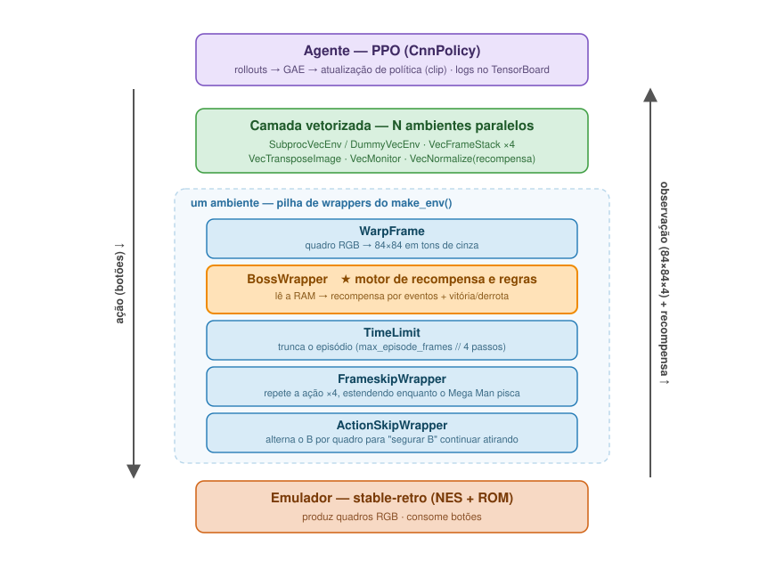

# Guia de Arquitetura

*Leia em outro idioma: [English](ARCHITECTURE.md) · **Português***

Este documento explica como o projeto é construído, o que cada classe faz e como as peças se
encaixam. Foi escrito para alguém que **nunca viu o código** e não se assume nenhum conhecimento
avançado de aprendizado por reforço (RL). Leia de cima para baixo e você conseguirá navegar pelo
código com confiança.

> Resumo — Uma rede neural aprende a jogar as lutas de chefe de *Mega Man* (NES) olhando para a tela
> (apenas os pixels) e apertando botões. O jogo roda dentro de um emulador; uma pilha de pequenas
> classes "wrapper" transforma os quadros crus na entrada da rede e transforma leituras da memória
> do jogo em uma recompensa numérica. O algoritmo PPO usa essa recompensa para melhorar a rede aos
> poucos. As seções 1 a 11 tratam dessa pilha do PPO; a seção 12 mostra como os algoritmos genéticos a
> reutilizam.

---

## 1. Que problema estamos resolvendo?

Queremos um agente (uma rede de política) que **derrote um chefe** em *Mega Man 1* usando apenas o
que um humano veria — os pixels na tela. O agente não tem acesso privilegiado ao estado interno do
jogo na sua *observação*: ele precisa inferir tudo (posição do inimigo, sua própria vida, o timing
dos projéteis) a partir da imagem.

Isso é formulado como um problema de **aprendizado por reforço**:

- A cada passo o agente recebe uma **observação** (a tela).
- Ele escolhe uma **ação** (uma combinação de botões).
- O ambiente devolve uma **recompensa** (um número pequeno que diz quão bem o agente está indo) e a
  próxima observação.
- O objetivo do agente é maximizar a recompensa total ao longo de um episódio (uma luta de chefe).

Usamos **PPO** (Proximal Policy Optimization), um algoritmo de RL popular e estável, da biblioteca
[stable-baselines3](https://stable-baselines3.readthedocs.io/). O jogo de NES é emulado pelo
[stable-retro](https://github.com/Farama-Foundation/stable-retro).

### Mini-glossário (o suficiente para continuar)

| Termo | Significado neste projeto |
|-------|----------------------------|
| **Episódio** | Uma luta de chefe, do reset até o chefe morrer, o jogador morrer ou um limite de tempo. |
| **Política** | A rede neural que mapeia uma observação em uma ação. |
| **Observação** | Uma imagem 84×84 em tons de cinza, empilhada nos últimos 4 quadros (`84×84×4`). |
| **Ação** | Uma escolha `MultiDiscrete([2, 5, 2])` `[B, D-pad, A]`: tiro, uma direção do D-pad (ou nenhuma), pulo. |
| **Recompensa** | `r = d·(acertos − m·dano)`, em que acertos e dano são *eventos* (um passo em que o chefe / o Mega Man perdeu HP); pequeno positivo por acertar o chefe, negativo por sofrer dano. |
| **Frameskip** | O agente age uma vez a cada N quadros do emulador (aqui N=4), num ritmo mais humano. |
| **Empilhamento de quadros** | Fornecer os últimos 4 quadros para a rede perceber movimento/velocidade. |
| **PPO** | O algoritmo de treino que atualiza a política a partir da experiência coletada. |
| **GAE** | Generalized Advantage Estimation — como o PPO estima "quão melhor que a média" uma ação foi. |
| **HP do chefe** | A vida do chefe, lida da RAM do emulador. Chegar a 0 = vitória. |
| **Validação vs teste** | Validação: o episódio determinístico único que o `train.py` joga a cada ~100k passos para parar e escolher o `best_model.zip`. Teste: `src/eval.py`, muitos episódios, opcionalmente com sticky actions e no-op starts. |

---

## 2. A visão geral

Os dados fluem em um laço fechado. O emulador produz um quadro; uma pilha de wrappers o transforma na
observação do agente e converte leituras da memória do jogo em uma recompensa; o agente (PPO) escolhe
uma ação; os wrappers a traduzem de volta em botões; o emulador avança um passo. Periodicamente, o
PPO pega os dados `(observação, ação, recompensa)` coletados e melhora a política.



**Como ler o diagrama:** a seta da direita é a **observação + recompensa** subindo de baixo para
cima; a seta da esquerda é a **ação** descendo de cima para baixo. Comece de baixo: o **emulador**
emite um quadro RGB cru, que sobe pela pilha de wrappers de um ambiente (`make_env`) — cada wrapper
adiciona uma transformação — depois pela **camada vetorizada** que roda N cópias em paralelo e
empilha os últimos 4 quadros, e por fim chega ao **agente PPO**. A ação escolhida desce pelo mesmo
caminho, onde o `ActionSkipWrapper` a converte na cadência de botões correta do NES pouco antes de
chegar ao emulador. A caixa laranja em destaque, `BossWrapper`, é onde a recompensa e as condições de
vitória/derrota são calculadas.

Dois scripts comandam o caminho do PPO:

- **`src/train.py`** — monta o ambiente, cria o modelo PPO, roda o laço de treino e salva os
  checkpoints e o melhor modelo.
- **`src/eval.py`** — carrega um modelo salvo e mede se ele derrota o chefe (taxas de vitória e de
  vitória sem dano com intervalos de confiança, opcionalmente sob sticky actions e no-op starts).

Eles dependem de **`src/env.py`** (para construir ambientes) e de **`src/wrappers.py`** (as classes
de transformação). O jogo em si vem de **`custom_integrations/`** mais um ROM fornecido pelo usuário.

---

## 3. Estrutura do repositório

```
src/
  wrappers.py   # as classes de transformação (o coração do ambiente)
  env.py        # funções fábrica que montam e vetorizam ambientes
  train.py      # ponto de entrada do treino (PPO + callbacks + a "receita" fixa)
  eval.py       # avaliação de teste (sticky actions, no-op starts, intervalos de Wilson)
  __init__.py   # torna `src` um pacote importável
baselines/ga/                         # Deep GA e GA de malha aberta (seção 12)
experiments/fair/                     # a campanha de comparação (veja EXPERIMENTS.pt-BR.md)
tests/                                # suíte pytest (testes do emulador são pulados sem rom.nes)
custom_integrations/MegaMan-v1-Nes/   # a definição do jogo para o stable-retro (sem o ROM)
docs/ARCHITECTURE.pt-BR.md            # este arquivo
docs/EXPERIMENTS.pt-BR.md             # protocolo da campanha de comparação
environment.yml / requirements.lock.txt   # ambiente exato (lock = pip freeze completo)
README.md / README.pt-BR.md           # guia de uso (inglês / português)
CITATION.cff                          # como citar
```

Gerados em tempo de execução (não versionados): `logs/` (TensorBoard e `run_meta.json`),
`checkpoints/`, `models/`, `campaign/`.

**Por onde começar a ler:** `src/wrappers.py` (entender o ambiente), depois `src/env.py` (como ele é
montado), depois `src/train.py` (como ele é treinado), depois `src/eval.py`.

---

## 4. O ambiente, wrapper por wrapper

Um "wrapper" é uma classe que envolve outro ambiente, interceptando `reset()` e `step()` para
adicionar comportamento. Eles operam em camadas aninhadas: cada wrapper delega para o que está dentro dele. A ordem
importa. Do mais interno (mais perto do emulador) ao mais externo (mais perto do agente), como
montado em `make_env`:

```
stable_retro.make(...)        # ambiente NES cru: imagem RGB entra, botões saem
  └─ ActionSkipWrapper        # corrige a cadência do botão de tiro (por quadro do emulador)
       └─ FrameskipWrapper     # age a cada 4 quadros (estendido sobre quadros de "piscada")
            └─ TimeLimit        # trunca o episódio após max_episode_frames // 4 passos do agente
                 └─ BossWrapper  # calcula a recompensa e as condições de vitória/derrota
                      └─ WarpFrame  # converte a imagem para 84×84 em tons de cinza (mais externo)
```

### 4.1 `ActionSkipWrapper`

**Problema que resolve:** No NES, o Mega Man atira só quando você *aperta* o B — segurar o B não faz
nada depois do primeiro tiro. Uma política que aprendesse a "segurar o B" atiraria uma vez e pararia.

**O que faz:** Mantém um bit alternador (`b_state`). Quando o agente pede "atirar" (`action[0] == 1`),
ele deixa o aperto passar em uma chamada e força a soltura na seguinte, de modo que uma política que
simplesmente segura o B ainda dispara uma rajada contínua. O botão de pulo (A) **não** é alternado.

O alternador roda **por quadro do emulador**, e não por passo do agente: este wrapper fica *dentro* do
`FrameskipWrapper`, que o chama uma vez para cada um dos 4 quadros repetidos. Segurar o B produz,
portanto, `1, 0, 1, 0` no nível dos quadros, isto é, duas bordas de aperto por passo do agente.

> Layout de ação usado em todo o código: `action[0]` = B (tiro), `action[1]` = D-pad
> (nada / UP / DOWN / LEFT / RIGHT, nesta ordem de índices), `action[2]` = A (pulo). É um espaço
> `MultiDiscrete([2, 5, 2])`. **Esta não é a ordem do `scenario.json`** (que lista o D-pad, depois A,
> depois B): o stable-retro ordena os grupos de botões e as combinações dentro de cada grupo pela
> máscara de bits dos botões, então a ordem dos índices é `[B, D-pad, A]` e as combinações do D-pad
> saem como nada, UP, DOWN, LEFT, RIGHT. O `tests/test_env_contract.py` fixa esse layout.

### 4.2 `FrameskipWrapper`

**Problema que resolve:** O NES roda a ~60 quadros/segundo. Decidir 60 vezes por segundo é
desperdício e dificulta a atribuição de crédito. Além disso, logo após sofrer dano o Mega Man
"pisca" (fica invisível), então parte desses quadros carrega pouca informação visual útil. O wrapper
tenta pulá-los, mas só de forma aproximada (veja abaixo).

**O que faz:**
- Repete a ação escolhida por `skip` (=4) quadros do emulador, somando as recompensas.
- Depois continua avançando, repetindo a mesma ação, *enquanto `blink_counter % 4 ∈ {1, 2}`* (e
  `blink_counter > 0`), até um teto de segurança de 60 quadros extras. Ou seja, um passo do agente
  são 4 quadros mais uma extensão de até 60 quadros.
- `blink_counter` (RAM 85) é um temporizador de quadros de invencibilidade, não um indicador de
  renderização, então a checagem é uma heurística e é imprecisa: medido no emulador, quando
  ela prediz "invisível" (`blink_counter % 4 ∈ {1, 2}`) o Mega Man está de fato visível em ~40% dos
  quadros, e quando prediz "visível" ele está visível em apenas ~90%. O contador também decrementa
  de forma irregular (a cada 1-2 quadros) e pode congelar. Logo, a próxima observação do agente
  **não** é garantidamente um quadro visível.
- Durante a extensão o agente **não tem controle**: a ação escolhida no passo é repetida às cegas,
  por até ~1 s de tempo de jogo logo após levar dano. Os passos têm, portanto, duração variável
  (média ~4,2-4,4 quadros, até 20% dos passos com mais de 4 quadros, máximo observado de 47), o que
  torna o processo um semi-MDP com duração de passo não declarada, e o `TimeLimit` (abaixo) conta
  passos do agente, não quadros, de modo que o episódio pode durar mais que `max_episode_frames`.

### 4.3 `TimeLimit` (do Gymnasium)

Um wrapper padrão que trunca o episódio após `max_episode_steps`. Nós o calculamos como
`max_episode_frames // frameskip` (7200 quadros = 1800 passos do agente com skip 4). Ele conta passos
do agente, então a duração em quadros não é exata enquanto a extensão de piscada roda.

### 4.4 `BossWrapper` — o motor de recompensa e regras

Este é o wrapper mais importante. Ele lê a RAM do jogo a cada passo e a transforma na recompensa e
nas condições de fim de episódio. Ele nunca altera a *imagem* que o agente vê; só altera a
*recompensa* e os sinais de *done* (e expõe valores úteis no dicionário `info`).

**Função de recompensa** (calculada em `step`, uma vez por passo do agente):

```
reward  = d                       se o chefe perdeu HP neste passo        (um acerto entrou)
reward -= d * damage_penalty_mult se o Mega Man perdeu HP neste passo     (sofreu dano)
reward += win_bonus               no passo em que o chefe chega a 0 de HP  (terminal)
```

com `d = 0.05`. Durante o **treino** `damage_penalty_mult = 2.0` e `win_bonus = 0.5`; durante a
**avaliação** eles voltam para `1.0` e `0.0` (a tarefa real). É por isso que um episódio de
avaliação *flawless* (matar o chefe sem sofrer dano) pontua exatamente `acertos · d`.

Os dois primeiros termos são **indicadores de evento**: um passo conta uma vez, quer o chefe tenha
perdido 1 ou 14 de HP, quer o Mega Man tenha perdido 4 ou 10 de HP (o dano por evento depende do
inimigo). A recompensa, portanto, ignora as magnitudes de HP e não é comparável entre chefes; para
isso use o HP perdido, os eventos de dano e os quadros até o abate reportados pelo `src/eval.py`.

**Condições de terminação** (o episódio acaba quando):
- a vida do Mega Man chega a 0, ou o contador de vidas cai (morte);
- o Mega Man toca espinhos (`touching_obj_top == 3` ou `touching_obj_side == 3`);
- a vida do chefe chega a 0 (**vitória**);
- a munição acaba com o chefe ainda vivo (`weapon_energy == 0`; ela fica em 28 com o buster, então
  isso só importa para armas com munição limitada).

O episódio também termina por truncamento no `TimeLimit`. Um chefe de múltiplas fases (ex.: as lutas
do Dr. Wily), cuja barra de HP chega a 0 entre as fases, encerraria o episódio no primeiro zero e
contaria como falsa vitória; as seis lutas usadas aqui têm fase única, então isso não as afeta.

**Valores de RAM que ele lê**, via as variáveis nomeadas da integração (o mapa completo, com o
significado verificado de cada endereço, está na seção 8): `health`, `lives`, `boss_health`,
`weapon_energy`, `touching_obj_top`, `touching_obj_side` (recompensa e terminação), além de `x`, `y` e
`screen`, que só são repassados ao `info`. No `reset` ele lê os
valores reais da RAM com `lookup_value`. Nada disso é adicionado à observação do agente.

**Auxiliar:** `_info_dict(...)` monta o dicionário `info` de cada passo (`hp`, `boss_hp`, `lives`,
`x`, `y`, `screen`, `weapon_energy`) em um só lugar, usado de forma idêntica por `reset` e `step`. O
`VecMonitor` registra o `hp` e o `boss_hp` finais de cada episódio a partir dele, e é assim que o
`train.py` classifica os episódios de validação.

> Detalhe sutil mas importante tratado no `reset`: o dicionário `info` do stable-retro geralmente retorna **vazio** logo
> após um reset. Depender de um padrão incorreto para `lives` registraria incorretamente a
> perda de uma vida e encerraria o episódio prematuramente.
> Portanto, o `reset` lê os valores **reais** direto da RAM via `lookup_value`.

### 4.5 `WarpFrame`

Converte cada quadro RGB para tons de cinza e redimensiona para 84×84 (`cv2.cvtColor` + `cv2.resize`
com `INTER_AREA`). É o pré-processamento padrão estilo Atari: cor é desnecessária e uma imagem menor
é muito mais barata para a CNN. Formato de saída: `(84, 84, 1)`. É o wrapper **mais externo**, então
sua saída é exatamente o que a camada vetorizada (próxima seção) empilha e entrega à política.

---

## 5. Montando e vetorizando ambientes — `src/env.py`

`env.py` contém as funções fábrica que constroem a pilha de wrappers acima e então rodam muitas
cópias dela em paralelo.

- **`_register_custom_integrations()`** — diz ao stable-retro onde encontrar nosso jogo customizado
  (`custom_integrations/`). Roda uma vez por processo (uma flag de guarda evita registrar de novo).
  Isso importa porque os workers paralelos são processos separados que reimportam o módulo.

- **`_verify_rom(game)`** — confere o `rom.nes` contra o `rom.sha` com `stable_retro.data.verify_hash`
  (uma vez por processo e por jogo) e levanta um `RuntimeError` com instruções se o arquivo estiver
  ausente ou for de outra revisão/dump. O `stable_retro.make` sozinho só checa que o `rom.nes` existe,
  então sem essa verificação um ROM diferente carregaria em silêncio, com os endereços de RAM
  apontando para os bytes errados. A convenção do hash é o SHA-1 do ROM **sem** o header iNES de 16
  bytes (veja a seção 8).

- **`make_env(...)`** — constrói **um** ambiente: registra a integração, verifica o ROM, chama
  `stable_retro.make(...)` com `inttype=CUSTOM_ONLY` (usar só nossa integração), ações
  `MULTI_DISCRETE` e observações `IMAGE`, e então o envolve na cebola da Seção 4. Retorna um único
  ambiente Gym. Os parâmetros de recompensa (`d`, `win_bonus`, `damage_penalty_mult`), `frameskip`,
  `max_episode_frames` e `sticky` são repassados direto aos wrappers.

- **`make_venv(...)`** — constrói **N** ambientes e coloca a camada vetorizada por cima:
  1. `SubprocVecEnv` (processos paralelos) se `n_envs > 1`, senão `DummyVecEnv` (no mesmo processo).
  2. `VecFrameStack(n_stack=4)` — empilha os últimos 4 quadros em cinza → a entrada real do agente
     vira `84×84×4`. É isso que permite a uma CNN sem recorrência perceber movimento.
  3. `VecTransposeImage` — reordena os eixos para o formato do PyTorch `(canais, altura, largura)`.
  4. `VecMonitor(info_keywords=("hp", "boss_hp"))` — registra estatísticas dos episódios.
  5. `VecNormalize(norm_obs=False, norm_reward=True)` — normalização opcional (running) só da
     **recompensa** (nunca da imagem), que afia o sinal de aprendizado e é segura para avaliação.

  Para evitar duplicar a longa lista de parâmetros, os ajustes por ambiente são reunidos uma vez em um
  dict `env_kwargs` e repassados a cada worker.

O resultado de `make_venv` é o único objeto com o qual o PPO interage: chamar `.step(actions)` nele
avança todos os N ambientes de uma vez e retorna observações, recompensas e flags de `done` em lote.

---

## 6. Treino — `src/train.py`

### 6.1 A "receita" (constantes de módulo)

Como os hiperparâmetros e a recompensa são **os mesmos para todos os chefes**, eles ficam em
constantes no topo do arquivo. Só `LR` e `ENT_COEF` podem ser sobrescritos (`--lr`, `--ent-coef`), o
que o ajuste de hiperparâmetros da campanha de comparação utiliza.

- Recompensa: `D = 0.05`, `DAMAGE_PENALTY_MULT = 2.0`, `WIN_BONUS = 0.5`, `FRAMESKIP = 4`,
  `NORM_REWARD = True`.
- PPO: `LR = 2.5e-4` (decaimento linear), `ENT_COEF = 5e-3`, `TARGET_KL = 0.05`, `GAMMA = 0.99`,
  `GAE_LAMBDA = 0.95`, `CLIP_RANGE = 0.2`, `VF_COEF = 1.0`, `MAX_GRAD_NORM = 0.5`, `N_STEPS = 1024`,
  `BATCH_SIZE = 128`, `N_EPOCHS = 4`, `N_EVAL_EPISODES = 1`, `SEED = 666` (o default do `--seed`).
- A política é a `CnnPolicy` do SB3 (NatureCNN) com extratores de features **separados** para o ator
  e o crítico.

As flags de linha de comando são:
- por execução: `--tag`, `--state`, `--seed`, `--timesteps`, `--n-envs`, `--episode-frames`;
- parada e regime: `--no-early-stop`, `--train-sticky`;
- ajuste: `--lr`, `--ent-coef`;
- reprodutibilidade: `--lr-horizon`, `--deterministic-torch`.

### 6.2 O schedule de learning rate

`lr_at_step(step, initial_value, horizon)` é `initial_value · max(0, 1 − step/horizon)`, e
`linear_schedule(initial_value, horizon, total_steps)` a envolve para o SB3 (que a chama com
`progress_remaining`, mapeado de volta ao passo absoluto). O LR decai linearmente até 0 em
`--lr-horizon` (default: `--timesteps`, 40 M) e permanece em 0. A campanha fixa `--lr-horizon` em 40 M, de
modo que o schedule não depende do orçamento de 3 M.

O decaimento é uma escolha de agendamento, e não algo mostrado como benéfico por si só. Com orçamento
de 3 M e horizonte de 40 M, o LR que o agente vê fica perto do inicial (em 2 M passos ele é 95% do
inicial), e por isso o `--lr-horizon` é explícito.

### 6.3 Callback de validação (`ValidationCallback`)

A cada `eval_freq` chamadas (~100k passos de ambiente) o `ValidationCallback`, uma subclasse fina do
`EvalCallback` do SB3, roda a política atual por **um episódio determinístico**
(`N_EVAL_EPISODES = 1`) em um **ambiente de avaliação separado** (a tarefa *real* — sem reward
shaping, `damage_penalty_mult = 1.0`, sem win bonus). Isto é *validação*: uma única trajetória, pois
tanto o emulador quanto a política são determinísticos ali. Ele:
- registra `eval/mean_reward` e `eval/mean_ep_length` no TensorBoard e, adicionalmente,
  `eval/win_rate` e `eval/no_damage_rate`, classificando cada episódio pelo `hp` / `boss_hp` finais
  que o `VecMonitor` registra (vitória = chefe em 0 com o Mega Man vivo; vitória sem dano = vitória
  com 28 de HP sobrando);
- salva `best_model.zip` sempre que a recompensa média de validação melhora;
- para o treino após a primeira validação cujos episódios são todos vitórias sem dano
  (`stop_on_no_damage`, lidas do `info`), a menos que `--no-early-stop` seja usado.

Como a validação é uma trajetória determinística, "parou numa vitória sem dano" não é evidência de que
a política é robusta; o `src/eval.py` (seção 7) é o teste.

### 6.4 `main()` — o procedimento de treino

1. Faz o parse das flags.
2. Configura o determinismo do torch se `--deterministic-torch` (kernels determinísticos,
   `CUBLAS_WORKSPACE_CONFIG`). Sem ele o script liga o `cudnn.benchmark`, mas a semeadura do SB3
   (`PPO(seed=...)`) força `cudnn.deterministic=True` e `benchmark=False`, então essa linha não tem
   efeito duradouro; o não determinismo restante vem de operações CUDA não determinísticas.
3. Constrói dois ambientes com `make_venv`:
   - **ambiente de treino** — com a penalidade de dano 2× e o win bonus, mais sticky actions se pedido;
   - **ambiente de avaliação** — a tarefa real (sem shaping), um único ambiente, usado pelo callback.
4. Cria os callbacks:
   - `RunMetaCallback` — grava os metadados da execução no TensorBoard como texto;
   - `CheckpointCallback` — salva um checkpoint (e suas estatísticas do `VecNormalize`) a cada ~500k
     passos;
   - `ValidationCallback` — valida a cada ~100k passos, salva o melhor modelo, aplica a regra de parada.
5. Cria o modelo PPO com `CnnPolicy`, as constantes da receita e `--seed`.
6. Grava `logs/<tag>/run_meta.json` (versões das bibliotecas, commit git e flag de árvore suja,
   hardware, argumentos da CLI, constantes da receita, flags de determinismo do torch).
7. Chama `model.learn(...)`. O PPO repetidamente: coleta um rollout de experiência dos N ambientes
   paralelos, calcula as vantagens com **GAE** e atualiza a rede com o objetivo recortado do PPO.
8. Quando o treino acaba (early stop ou o teto de timesteps), salva `final_model.zip` (e suas
   estatísticas do `VecNormalize`) além do `best_model.zip` produzido pelo callback.

**Saídas** (namespaceadas por `--tag`): `logs/<tag>/` (TensorBoard, `run_meta.json`),
`checkpoints/<tag>/` (snapshots periódicos), `models/<tag>_best/best_model.zip` e
`.../final_model.zip`.

---

## 7. Avaliação — `src/eval.py`

Este script responde à pergunta *esse modelo salvo realmente derrota o chefe, e com que robustez?*
É o protocolo de **teste**, em oposição ao episódio único de validação da seção 6.3.

- **`make_eval_env(...)`** constrói a mesma pilha de wrappers do `make_env` para a tarefa real
  (`d=0.05`, penalidade 1×, sem win bonus), mais dois auxiliares logo acima do emulador,
  *abaixo* do `ActionSkipWrapper`:
  - `StickyFrames` — sticky actions **por quadro do emulador** (Machado et al. 2018): a cada quadro a
    ação do quadro anterior é repetida com probabilidade `--sticky`. Por ficar abaixo do
    `ActionSkipWrapper` e do `FrameskipWrapper`, tanto o alternador de B quanto o frameskip operam
    sobre as ações perturbadas;
  - `FrameCounter` — conta quadros reais do emulador e eventos de dano (quedas de `health`, quadro a
    quadro), independentemente de como os wrappers esticam um passo do agente.
- **`run_episode(...)`** — no-op start opcional (`--noop-max`: 0..N passos do agente sem botão), depois
  a política (`--deterministic`, o padrão, ou `--stochastic`). Cada episódio é semeado a partir de
  `--seed` por um `SeedSequence`, então o episódio `i` não depende dos anteriores.
- **Métricas por episódio:** vitória (chefe em 0 com o Mega Man vivo; uma morte simultânea conta como
  morte), vitória sem dano (vitória com o HP inicial intacto), HP perdido, eventos de dano, quadros do
  emulador até o abate (só para vitórias; o no-op start é excluído) e a recompensa.
- **Agregado:** proporções de vitória e de vitória sem dano com intervalos de Wilson de 95%
  (`wilson_interval`), média ± desvio para o resto, contagens de mortes, timeouts e mortes
  simultâneas; `--json CAMINHO` também salva a configuração e cada episódio.

Saída de exemplo (um teste de fumaça de 3 episódios com um modelo mal treinado de 20k passos,
mostrado apenas para ilustrar o formato, e não como resultado):

```
Evaluating final_model.zip on Gutsman-boss: 3 episodes (deterministic, sticky=0.25, noop_max=30, seed=0)
  ep   1: death   hp_lost=28 dmg_events=7 frames_to_kill=    - frames= 1255 reward=0.050
  ...
------------------------------------------------------------------------
Win            0/3 = 0%  (95% Wilson [0, 56])
No damage      0/3 = 0%  (95% Wilson [0, 56])
HP lost        28.00 +/- 0.00  (n=3)
...
```

Use o mesmo `--episode-frames` do treino. Como a tarefa de avaliação é a sem shaping, um episódio
flawless ainda pontua `acertos·d`; mas essa recompensa conta eventos, então compare chefes pelo HP
perdido, eventos de dano e quadros até o abate. Limitação: o episódio para no primeiro
`boss_health == 0`, então chefes de múltiplas fases dariam falsas vitórias (seção 4.4).

---

## 8. A definição do jogo — `custom_integrations/MegaMan-v1-Nes/`

O stable-retro traz uma integração oficial `MegaMan-Nes-v0` para este jogo. Este projeto não a usa:
fornece a **sua própria integração customizada**, `MegaMan-v1-Nes` (carregada com `CUSTOM_ONLY`), que
nomeia as variáveis de RAM de que o projeto precisa e carrega os save states por chefe. Ela contém:

- **`rom.nes`** — o jogo de fato (um ROM de NES). **Não incluído** por questões legais; você fornece o
  seu.
- **`rom.sha`** — o SHA-1 esperado do ROM **sem o header iNES de 16 bytes**
  (`6047e52929dfe8ed4708d325766ccb8d3d583c7d`), que é a convenção do stable-retro (o mesmo hash da
  integração oficial). O `make_env` o verifica (`_verify_rom`) e falha com uma mensagem clara; o
  `stable_retro.make` sozinho não. Confira um ROM com `tail -c +17 rom.nes | sha1sum`. (O SHA-1 do
  arquivo inteiro com header, `2f88381…`, é outro número para o mesmo ROM.)
- **`data.json`** — declara as **variáveis de RAM** que o projeto lê (seus endereços de memória e
  tipos); veja o mapa abaixo. Esses nomes são exatamente o que os wrappers consultam.
- **`scenario.json`** — declara os grupos de botões que formam o espaço de ações. Sua ordem (D-pad, A,
  B) **não** é a ordem dos índices do `MultiDiscrete([2, 5, 2])` resultante (`[B, D-pad, A]`, seção
  4.1). A lógica de recompensa/done de fato vive no `BossWrapper`, não aqui.
- **`metadata.json`** — metadados da integração (ex.: o estado inicial padrão).
- **`*.state`** — **save states**: snapshots do emulador que jogam o agente direto em uma luta de
  chefe específica (`Bombman-boss.state`, `Gutsman-boss.state`, …). São os pontos de partida por
  chefe selecionados com `--state`.

Quando `make_env` chama `stable_retro.make(..., inttype=CUSTOM_ONLY, state=<nome>)`, o stable-retro
carrega o ROM, aplica o save state nomeado e expõe as variáveis de RAM do `data.json` no dicionário
`info` a cada passo (mas não no `reset`, onde ele vem vazio).

**Mapa de RAM** (`data.json`; endereços em decimal, hex entre parênteses):

| Nome | Endereço | Significado verificado | Uso |
|------|----------|------------------------|-----|
| `health` | 106 (0x6A) | HP do Mega Man (0–28) | recompensa, terminação |
| `boss_health` | 1729 (0x6C1) | HP do objeto do slot 1, o chefe (0–28) | recompensa, vitória |
| `lives` | 166 | vidas | terminação |
| `x`, `y` | 1152, 1536 (0x480, 0x600) | posição do Mega Man (objeto do slot 0) | só `info` |
| `blink_counter` | 85 | temporizador de quadros de invencibilidade, decresce a partir de 111 com passo irregular; não é um indicador de renderização | extensão de piscada do `FrameskipWrapper` |
| `weapon_energy` | 111 | 28 com o buster | terminação por munição |
| `touching_obj_top`, `touching_obj_side` | 44, 148 | contato com espinhos quando vale 3; não verificado de forma independente (nenhuma terminação assim foi observada) | terminação |
| `screen` | 1120 (0x460) | índice da tela (significado não verificado aqui) | só `info` |

**RAM inicial dos save states.** Os seis estados não foram gravados de forma uniforme. Em todos,
`health = boss_health = weapon_energy = 28`, mas:

| Save state | `lives` | `blink_counter` |
|------------|:-------:|:---------------:|
| `Bombman-boss` | 9 | 3 (Mega Man ainda na piscada pós-dano) |
| `Cutman-boss` | 9 | 3 (idem) |
| `Gutsman-boss`, `Elecman-boss`, `Iceman-boss`, `Fireman-boss` | 9 | 0 |

É por isso que o `BossWrapper.reset` lê `lives` da RAM em vez de assumir um padrão. Recriar um estado
muda esses valores: o `tests/test_env_contract.py` fixa a tabela, então falha e precisa ser editado de
propósito.

---

## 9. Ciclo de vida ponta a ponta

```
   você fornece o rom.nes
          │
          ▼
  python src/train.py --tag bombman --state Bombman-boss
          │   monta o ambiente de treino (com shaping) + o de avaliação (real); verifica o ROM
          │   o PPO coleta rollouts → GAE → atualização da política  (repete)
          │   valida a cada ~100k passos (1 episódio determinístico) → salva o best_model quando melhora
          │   early stop na primeira validação vencida sem dano
          ▼
  models/bombman_best/best_model.zip
          │
          ▼
  python src/eval.py --model models/bombman_best/best_model.zip --state Bombman-boss \
                     --episodes 30 --sticky 0.25 --noop-max 30
          │   roda N episódios na tarefa real sob a perturbação escolhida
          ▼
  taxas de vitória / sem dano com IC de Wilson 95%, HP perdido, eventos de dano, quadros até o abate
```

A única diferença por chefe na receita padrão é o `--state`.

---

## 10. Decisões de projeto que vale conhecer

- **Só pixels.** Nenhum valor do estado do jogo é adicionado ao tensor de observação: HP, HP do chefe e
  posições são usados *apenas* para construir a recompensa e o sinal de done, e a política precisa
  aprender a ler a tela. Uma sutileza: a RAM `blink_counter` decide quantos quadros um passo abrange, e
  portanto qual quadro o agente vê em seguida.
- **Sem LSTM, sem currículo.** O empilhamento de quadros (4 quadros) dá à CNN sem recorrência o seu
  contexto temporal.
- **Uma receita genérica.** Os mesmos hiperparâmetros padrão e a mesma recompensa são usados nos seis
  chefes. O endereço do HP do chefe (1729) é o HP do objeto do chefe e é o mesmo em todas as lutas
  usadas aqui.
- **Reprodutibilidade.** Veja a seção de reprodução de [EXPERIMENTS.pt-BR.md](EXPERIMENTS.pt-BR.md).
- **Validação não é teste.** O early stop e o `best_model.zip` usam um episódio determinístico, que num
  emulador determinístico é uma única trajetória. A robustez (sticky actions, no-op starts, muitos
  episódios, intervalos de confiança) é medida com o `src/eval.py`.

---

## 11. Glossário de arquivos e classes (referência rápida)

| Símbolo | Arquivo | Papel |
|---------|---------|-------|
| `ActionSkipWrapper` | `wrappers.py` | Alterna o botão B por quadro do emulador para que "segurar B" continue atirando. |
| `FrameskipWrapper` | `wrappers.py` | Repete a ação por 4 quadros, estendendo enquanto o Mega Man pisca. |
| `BossWrapper` | `wrappers.py` | Lê a RAM → calcula a recompensa por eventos e vitória/derrota. |
| `WarpFrame` | `wrappers.py` | Quadro RGB → 84×84 em tons de cinza (wrapper mais externo). |
| `_register_custom_integrations` | `env.py` | Registra o jogo customizado no stable-retro (uma vez por processo). |
| `_verify_rom` | `env.py` | Confere o `rom.nes` contra o `rom.sha`; `RuntimeError` se não bater. |
| `make_env` | `env.py` | Constrói um ambiente envolvido pelos wrappers. |
| `make_venv` | `env.py` | Constrói N ambientes paralelos + frame stacking, transpose, monitor, normalize. |
| `lr_at_step`, `linear_schedule` | `train.py` | Decaimento do learning rate ancorado no passo absoluto (`--lr-horizon`). |
| `ValidationCallback` | `train.py` | Episódio de validação: melhor modelo, taxas de vitória / sem dano, parada sem dano. |
| `RunMetaCallback`, `collect_run_meta` | `train.py` | Metadados da execução (versões, commit, hardware) em `run_meta.json` e no TensorBoard. |
| `main` (train) | `train.py` | Monta tudo e roda o laço de treino do PPO. |
| `StickyFrames`, `FrameCounter` | `eval.py` | Sticky actions por quadro; contadores de quadros reais e de eventos de dano. |
| `make_eval_env` | `eval.py` | A pilha da tarefa real mais os dois auxiliares acima. |
| `run_episode`, `evaluate`, `summarize` | `eval.py` | Jogam episódios; agregam com intervalos de Wilson. |
| `main` (eval) | `eval.py` | CLI: carrega um modelo, avalia, imprime e salva JSON. |

---

## 12. Os algoritmos genéticos

Os GAs em `baselines/ga/` não modificam o `src/`. Eles reutilizam o ambiente e o avaliador e trocam o
algoritmo de aprendizado:

| | PPO | Deep GA | GA de malha aberta |
|---|---|---|---|
| Genoma ou parâmetros | `CnnPolicy` do SB3, ator e crítico separados | NatureCNN + cabeça linear com 2+5+2 logits (1.688.745 parâmetros), guardada como cadeia de sementes de mutação | sequência de ações conjuntas, um gene a cada `k` passos do agente |
| Entrada | pilha de quadros 4×84×84 | a mesma pilha, montada do mesmo modo | nenhuma |
| Atualização | gradiente de política com clipping | mutação gaussiana, seleção por truncamento, elitismo, sem crossover | crossover de dois pontos, reamostragem por gene, seleção por truncamento, elitismo |
| Objetivo | recompensa de treino descontada e normalizada | retorno não descontado da recompensa de treino | igual ao Deep GA |

Empates de fitness são desfeitos por vitória e depois por menos quadros até o abate. No treino
determinístico, só essa regra pode trocar o elite quando o melhor fitness para de mudar, então ela age
como uma pressão implícita por velocidade, que o objetivo do PPO não expressa da mesma forma.

| Arquivo | Papel |
|---------|-------|
| `common.py` | Tabela de chefes, tarefas de treino e avaliação, patch de sticky actions, execução de episódios, pool de processos (um emulador por processo). |
| `policy.py` | Rede do Deep GA e carregamento de um indivíduo salvo para o `src/eval.py`. |
| `fair.py` | Laço de busca da comparação, com as duas variantes, orçamento de passos, validação, treino com sticky actions e snapshots. |
| `evaluate.py` | Roda `src.eval.evaluate()` em um indivíduo salvo, com a mesma pilha, sementes e formato JSON do PPO. |
| `deep_ga.py`, `ga_ol.py` | Operadores de mutação, crossover e seleção; a cadeia de sementes do Deep GA. |

O uso está em [`baselines/ga/README.pt-BR.md`](../baselines/ga/README.pt-BR.md), e o protocolo que
compara os três métodos está em [EXPERIMENTS.pt-BR.md](EXPERIMENTS.pt-BR.md).
